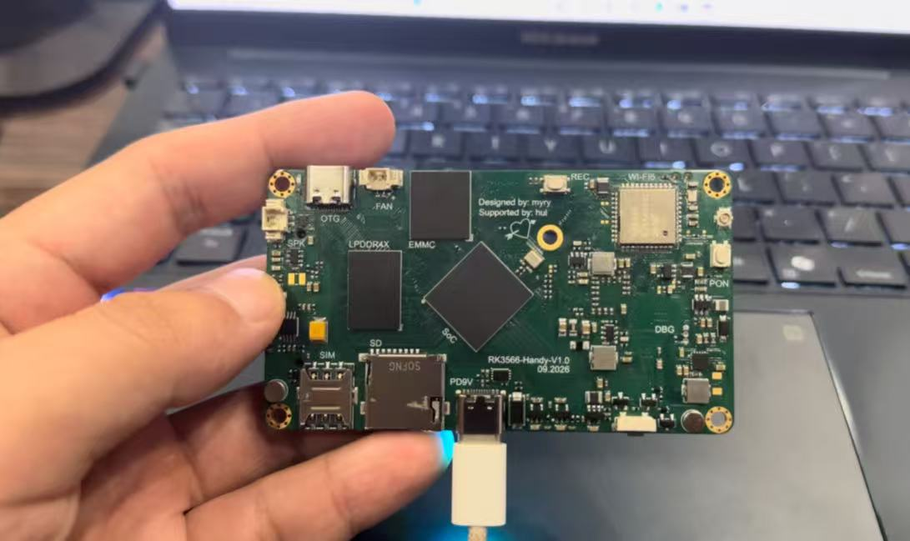
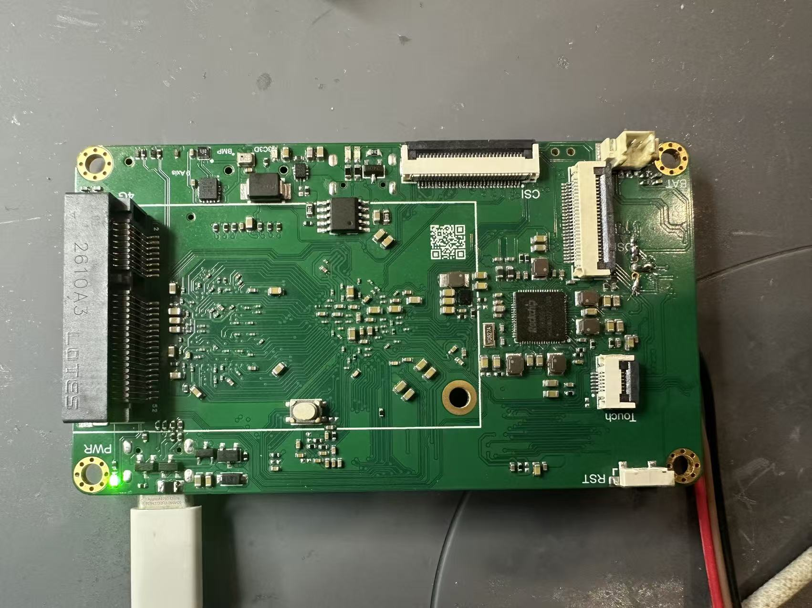
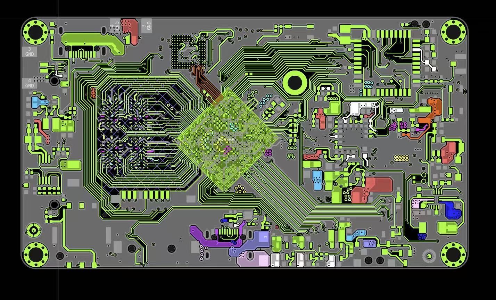
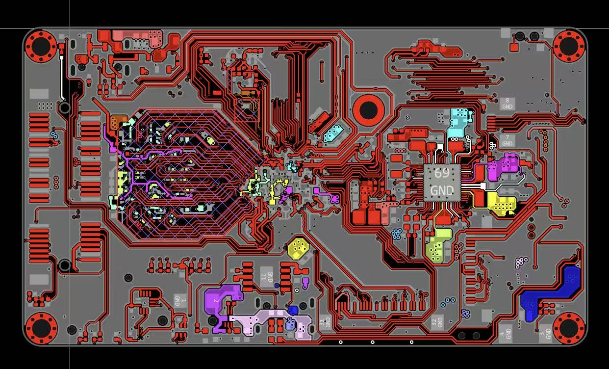
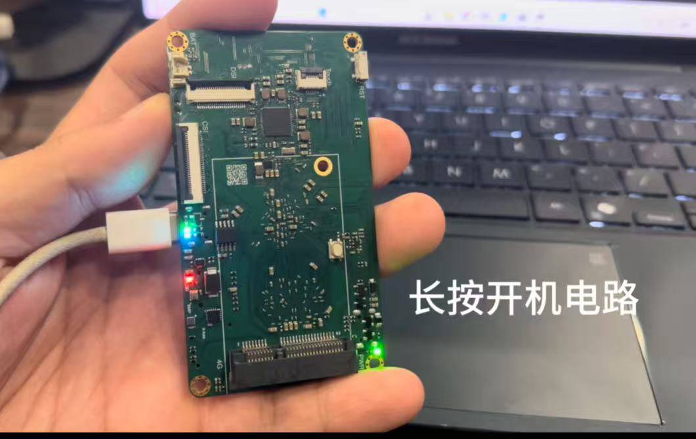
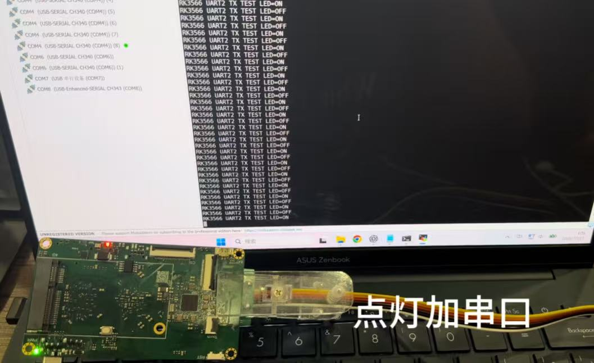

# RK3566 Smartphone

This is a smartphone designed in EasyEDA based on the RK3566 Hardware Design Kit (HDK).

  

  

  

  

## Core System

- Rockchip RK3566
- LPDDR4X memory
- eMMC storage
- Rockchip RK809 PMIC

## Peripherals

- USB OTG
- Debug UART
- Wi-Fi 6
- MicroSD card
- 4G module with SIM card slot
- Audio amplifier
- Microphone
- MIPI-DSI display interface
- MIPI-CSI camera interface
- 9-axis IMU
- Barometric pressure sensor
- Status LED

## Power Supply

- 9 V USB power negotiation input
- 7.4 V lithium battery input

## Project Status

**October 27, 2026**

The board has been assembled and powered on successfully.

The following functions have been verified at the U-Boot stage:

- GPIO control has been verified by blinking an LED.
- UART2 TX output has been verified at 1,500,000 baud.
- LPDDR4X initialization is functional.
- The eMMC can be detected, written, and read back successfully.
- Maskrom and Loader modes are functional.

A minimal Linux system image is currently being prepared for further hardware and peripheral testing.

  

  

